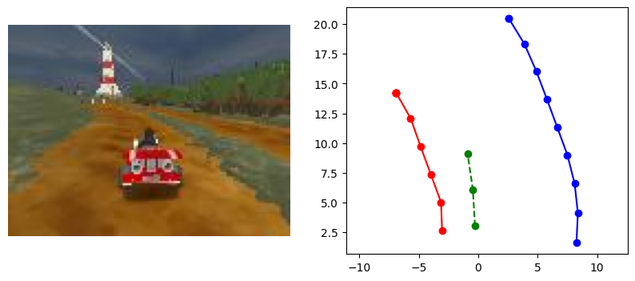
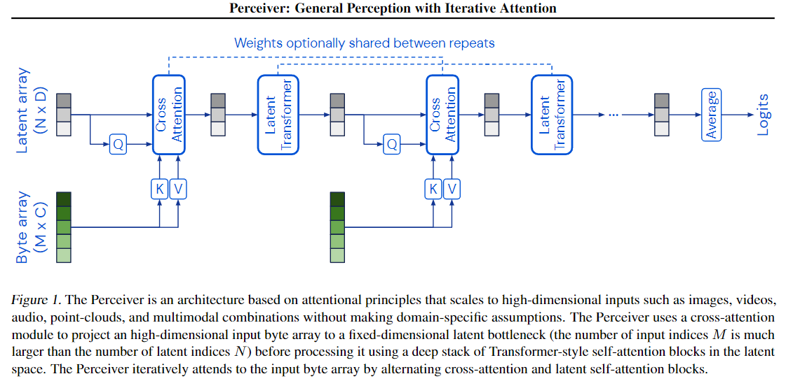

# Autonomous Driving with Deep Learning

Neural planners that drive a kart in [SuperTuxKart](https://supertuxkart.net/). Each model predicts the vehicle's next waypoints in its own coordinate frame, and a simple controller follows those waypoints to steer and set speed in the game.

I built and compared three approaches:

| Model | Input | Architecture |
|---|---|---|
| **MLP Planner** | Ground-truth lane boundaries | 4-layer MLP with dropout |
| **Transformer Planner** | Ground-truth lane boundaries | Perceiver-style encoder-decoder with learned waypoint queries |
| **CNN Planner** | Raw RGB camera image | 5-layer strided CNN backbone + MLP regression head |



## Highlights

- **Three planning architectures, one training pipeline.** I wrote a single training loop in `homework/train_planner.py` that works with any of the models. It picks the right inputs (lane boundaries or images) for each one and logs everything to TensorBoard.
- **Driving straight from pixels.** The CNN planner skips the usual segmentation → depth → reprojection steps. It goes directly from a `96×128` camera frame to future waypoints, so small depth errors don't get blown up during reprojection.
- **Perceiver-style attention.** The transformer encodes the 20 lane-boundary points with self-attention. Then `n_waypoints` learned query embeddings (`nn.Embedding`) cross-attend over that encoding, following [Perceiver](https://arxiv.org/abs/2103.03206), with the waypoint queries playing the role of the latent array.
- **Weighted L1 loss.** I wrote a loss that weights longitudinal error (a proxy for speed) separately from lateral error (a proxy for steering). The default is 5:1, which pushes the model harder on speed accuracy.
- **Lightweight models.** Every model fits in the 20 MB size budget and is small enough to run inside the game loop.

## Task

Inputs (from the SuperTuxKart Drive Dataset):

- `track_left`, `track_right`: `(10, 2)` lane boundary points in the ego frame
- `image`: `(3, 96, 128)` RGB frame from the kart's camera
- `waypoints`: `(3, 2)` target future positions (the regression target)

Output: `(B, 3, 2)` predicted waypoints.

Evaluation uses two offline metrics:

- **Longitudinal error**: absolute error along the forward axis (how well the model predicts speed)
- **Lateral error**: absolute error along the left/right axis (how well the model predicts steering)

| Model | Longitudinal error target | Lateral error target |
|---|---|---|
| MLP Planner | < 0.20 | < 0.60 |
| Transformer Planner | < 0.20 | < 0.60 |
| CNN Planner | < 0.30 | < 0.45 |

## Models

### MLP Planner
The left and right boundaries are concatenated and flattened into a 40-dim vector, then passed through `Linear(40→256) → ReLU → Dropout(0.3) → Linear(256→128) → ReLU → Dropout(0.3) → Linear(128→64) → ReLU → Linear(64→6)`. The output is reshaped to `(3, 2)`.

### Transformer Planner
- Each boundary point is projected to `d_model=64`
- 3-layer `TransformerEncoder` (4 heads) over the 20 boundary tokens
- 3 learned waypoint queries pass through a 3-layer `TransformerDecoder` that cross-attends over the encoded track
- A linear head maps each query to an `(x, y)` waypoint



### CNN Planner
- Per-channel input normalization using dataset mean and std
- 5 stride-2 `3×3` conv layers (16 → 32 → 64 → 128 → 256 channels), which downsample `96×128` to `3×4`
- MLP head `3072 → 512 → 256 → 6`, reshaped to `(3, 2)` waypoints

## Project Structure

```
homework/
  models.py           # MLPPlanner, TransformerPlanner, CNNPlanner
  train_planner.py    # Training loop with weighted L1 loss + TensorBoard logging
  metrics.py          # Longitudinal / lateral error metrics
  datasets/           # Data loading and transforms
  supertux_utils/     # Game wrapper + driving visualization
grader/               # Offline evaluation suite
assets/               # Figures
```

## Getting Started

```bash
pip install -r requirements.txt

# Download the dataset
curl -s -L https://www.cs.utexas.edu/~bzhou/dl_class/drive_data.zip -o ./drive_data.zip && unzip -qo drive_data.zip
```

### Train

```bash
PYTHONPATH=homework:. python3 -c "from train_planner import train; train(model_name='mlp_planner')"
PYTHONPATH=homework:. python3 -c "from train_planner import train; train(model_name='transformer_planner')"
PYTHONPATH=homework:. python3 -c "from train_planner import train; train(model_name='cnn_planner')"
```

Training logs go to `logs/` (view them with `tensorboard --logdir logs`). Trained weights are saved to `homework/<model_name>.th`.

### Evaluate

```bash
python3 -m grader homework -v
```

### Watch it drive (optional)

```bash
pip install PySuperTuxKartData
pip install PySuperTuxKart --index-url=https://www.cs.utexas.edu/~bzhou/dl_class/pystk

python3 -m homework.supertux_utils.evaluate --model cnn_planner --track lighthouse
```

## Tech Stack

Python · PyTorch · TensorBoard · PySuperTuxKart · NumPy · Matplotlib

## Acknowledgments

Built as part of UT Austin's Deep Learning course. The dataset, grader, and game utilities were provided by the course staff.
